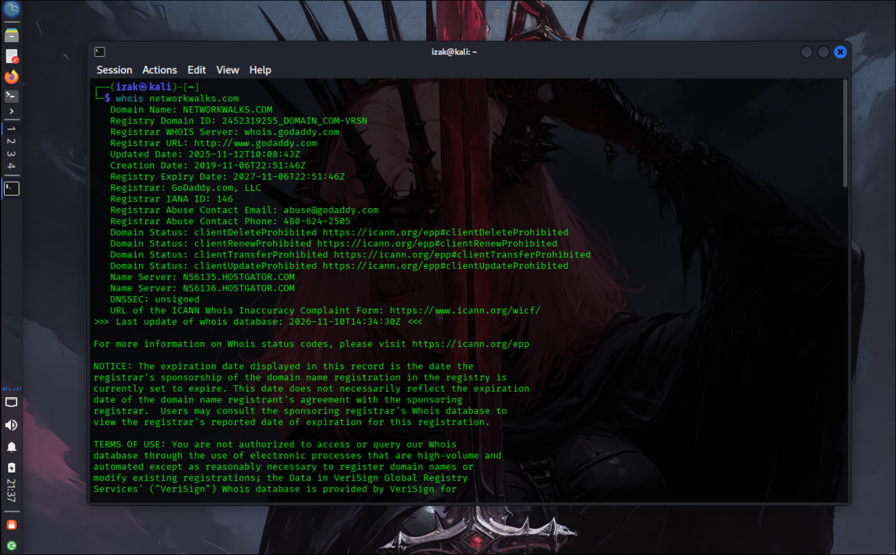
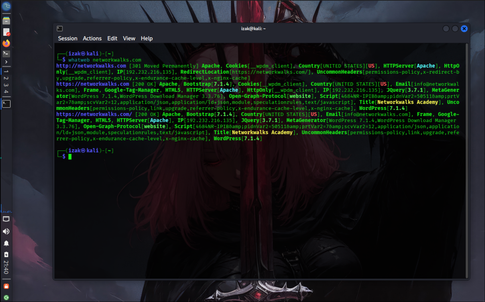
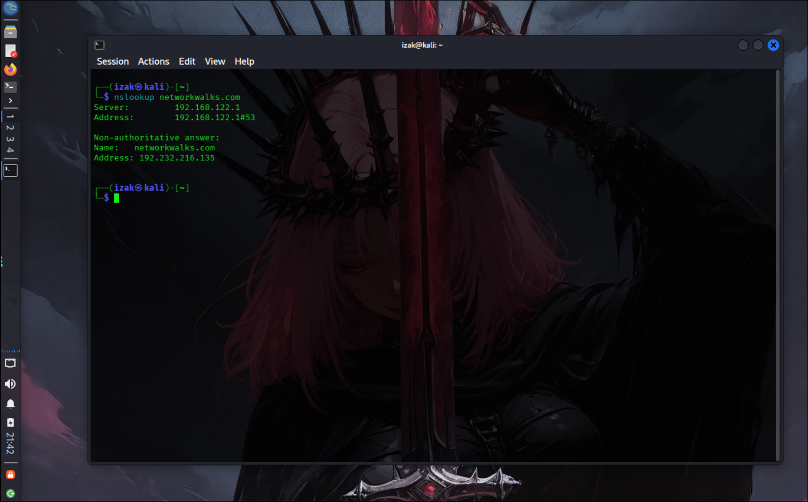
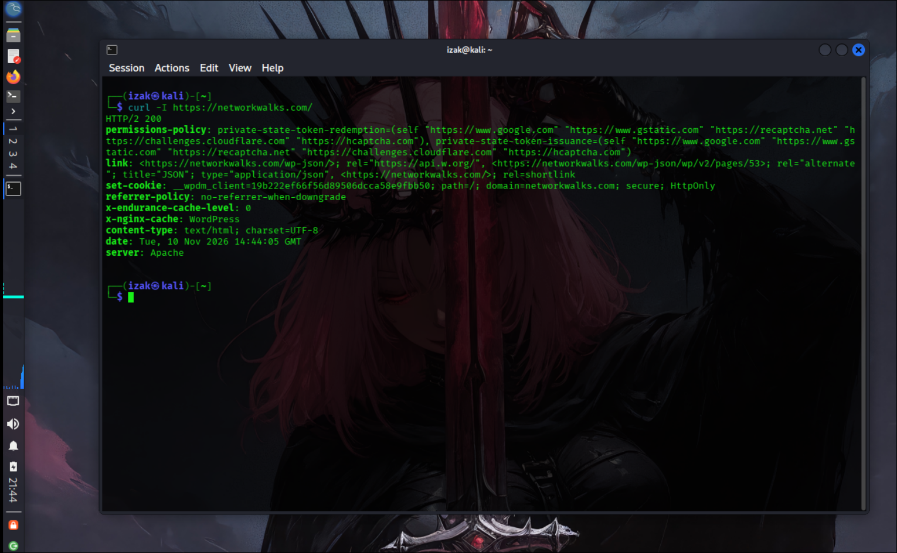
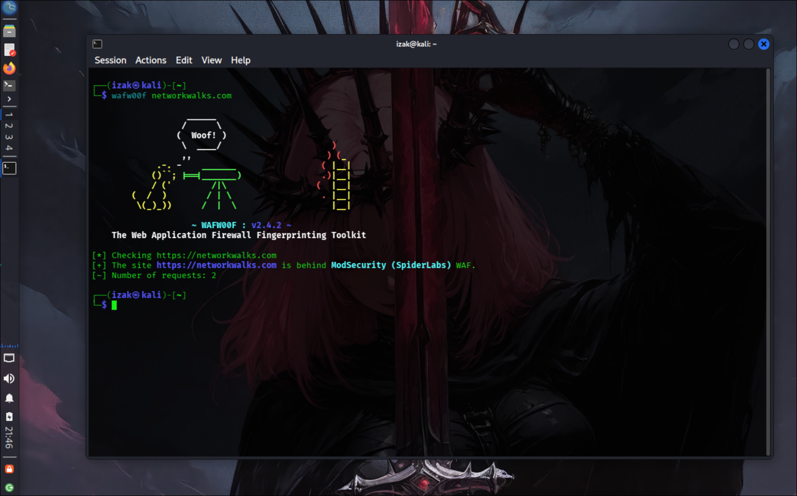
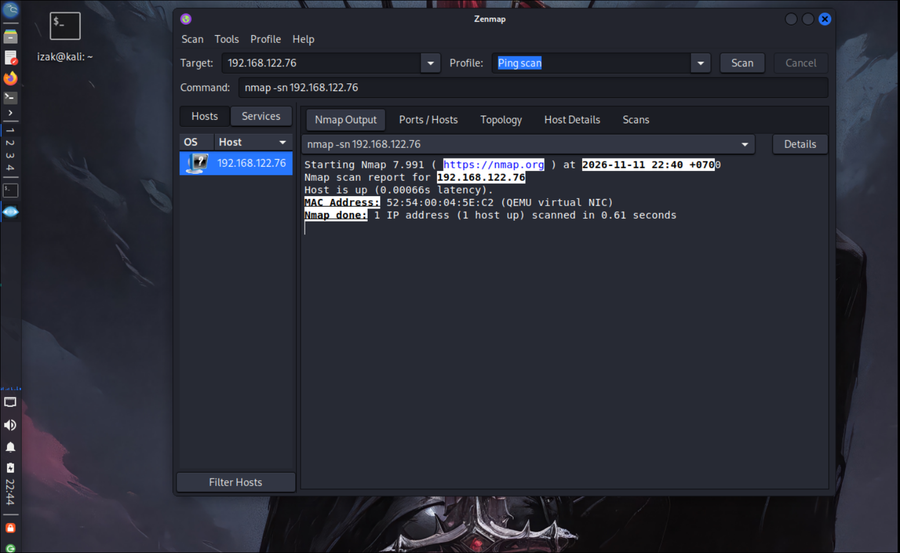
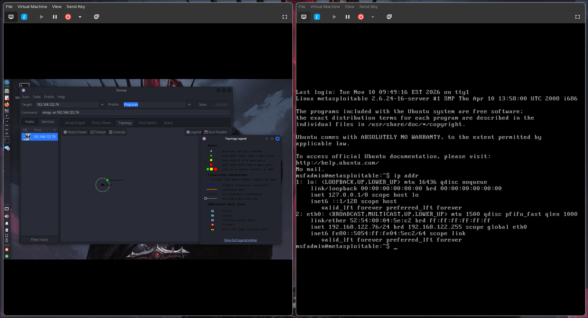

# PENETRATION TESTING REPORT
### Footprinting & Network Scanning Phases

**W2-PM-FINAL  |  CYBERSECURITY  |  NETWORKWALKS**

| Field | Detail |
|---|---|
| **Pentester Name (Cybersecurity Professional)** | **Yin Keo Odom** |
| **Program/Batch** | B084-Networkwalks |
| **Date** | 11 October 2026 |
| **Modules completed** | W2-PM1 (Multiple Kali Tools) W2-PM5 (Zenmap Scanning) |
| **Client/Target** | 1. Networkwalks (secured written permission already) 2. Metaploit2 Lap |
| **Permission secured from client?** | Yes |
| **Phases covered** | **Phase 1:** Reconnaissance & Footprinting **Phase 2:** Scanning & Network Discovery **Phase 3-5:** In Progress |

# 1. Liability Disclaimer

All activities described here were performed either on systems and networks for which I had obtained permission from Networkwalks or on my own devices and personal network for testing and experimentation. Any scanning, vulnerability assessment, or exploitation using tools such as Metasploit 2 was conducted only within my own authorized lab environment.

All materials are intended strictly for educational and research purposes. Unauthorized testing or access to systems without proper permission is strictly prohibited. I take full responsibility for my actions and the use of the knowledge presented here. Unauthorized access may violate applicable laws and can result in legal consequences, including fines, criminal charges, and other penalties.

# 2. Introduction

This report covers two practical activities from Week 2 of my internship at Networkwalks: footprinting the `networkwalks.com` domain using Kali Linux (W2-PM1) and scanning my own laptop and local network using Metasploit 2 (W2-PM5).

The footprinting activity focuses on gathering publicly available information about a domain, while the scanning activity explores identifying live hosts, open ports, and potential vulnerabilities in my own network environment. Each section includes the tools and commands used, observed results, screenshots as evidence, and brief security explanations.

# 3. Tools Used

The table below lists each tool used in this report and its purpose.

| Tool | Purpose |
|---|---|
| Kali Linux & Windows | Operating systems used for reconnaissance and scanning activities. |
| WHOIS | Find domain registration details, including owner, dates, and name servers. |
| WhatWeb | Identify website technologies, servers, CMS, and plugins. |
| nslookup | Resolve domain names to IP addresses using DNS. |
| curl -I | Retrieve HTTP response headers from a website. |
| wafw00f | Detect whether a Web Application Firewall (WAF) protects a website. |
| dnsrecon | Enumerate DNS records, including NS, MX, SPF, TXT, and SRV. |
| Zenmap (Nmap GUI) | Scan my local network to identify live hosts, IP addresses, and MAC addresses. |
| Windows CMD | Identify local IP and MAC addresses. |
| Metasploit 2 | Perform security testing and vulnerability assessment in my own lab environment. |

# 4. Activities Performed

## 4.1 Footprinting & Reconnaissance

I performed reconnaissance on the `networkwalks.com` domain using six Kali Linux tools: **WHOIS, WhatWeb, Nslookup, Curl, Wafw00f, and DNSRecon**. Each tool helped gather different types of publicly available information about the target.

- **WHOIS:** Collected domain registration details and identified name servers.
- **WhatWeb:** Identified website technologies, including WordPress 7.1.4 and WP Download Manager 3.3.76.
- **Nslookup:** Resolved the domain name to the IP address `192.232.216.135`.
- **Curl:** Used the `-I` option to inspect HTTP response headers and identify the WordPress REST API endpoint (`/wp-json/`).
- **Wafw00f:** Detected ModSecurity (SpiderLabs) as the Web Application Firewall.
- **DNSRecon:** Enumerated DNS records, including name servers, mail servers, SPF/TXT records, and service records.

These findings provided an overview of the domain's registration details, DNS configuration, web technologies, and security infrastructure.

## 4.2 Network Scanning with Zenmap

For the second activity, I used **Zenmap** to perform network discovery on my local network. The practical required me to identify my local IP address and subnet, discover live hosts, identify their IP and MAC addresses, and generate a network topology.

I first used the Windows `ipconfig` command to identify my local IP address and LAN subnet. I then entered the subnet into Zenmap and selected **Ping Scan** to identify active hosts.

The example results provided in the practical identified four live hosts:

- `192.168.122.1`
- `192.168.122.76`
- `192.168.122.204`

The example results also included four MAC addresses.

After completing the scan, I opened the **Topology** section in Zenmap, enabled the legend and saved the network topology in PDF format as required by the practical task.

**Note:** The actual subnet, number of hosts and addresses should be replaced with the results from my own network when submitting the report.

# 5. Risk Analysis / Impact

Based on the information collected during the footprinting and network scanning activities, I identified the following potential risks.

| # | Risk / Finding | Evidence / Observation | Potential Impact | Risk Level |
|---|---|---|---|---|
| 1 | Web technology information exposed | WhatWeb identified WordPress and WP Download Manager. | May help attackers identify software versions and potential vulnerabilities. | **● Low** |
| 2 | Server IP address identifiable | Nslookup resolved the domain to `192.232.216.135`. | Reveals the public IP address associated with the domain. | **● Low** |
| 3 | HTTP technical information exposed | Curl returned HTTP headers and exposed `/wp-json/`. | May assist technology fingerprinting and further enumeration. | **● Low** |
| 4 | WAF technology identifiable | Wafw00f identified ModSecurity (SpiderLabs). | Reveals information about the website's security infrastructure. | **● Low** |
| 5 | DNS infrastructure information exposed | DNSRecon identified DNS, mail, and service-related records. | Helps build a profile of the domain's infrastructure. | **● Low** |
| 6 | Metasploitable 2 host identified | Zenmap Ping Scan confirmed that `192.168.122.76` was up. | Confirms that the lab target is reachable on the local network. | **● Informational** |

**Risk level key:** ● Critical ● Medium ● Low

The findings above are observations from the footprinting and scanning exercises, not confirmed vulnerabilities. The practical activities primarily involved information gathering and host discovery. No exploitation or vulnerability validation was performed during these exercises.

The presence of information such as software versions, IP addresses, or DNS records does not automatically indicate a security vulnerability. Further authorized testing would be required to confirm any actual weaknesses.

# 6. Recommendations

1. Based on the observations from these activities, I recommend the following security improvements:

2. Update Software: Keep CMS platforms, plugins, and services updated.

3. Review Information Exposure: Avoid exposing unnecessary technical details through HTTP headers and website configurations.

4. Secure DNS: Regularly review DNS records and remove unnecessary entries.

5. Monitor Network Devices: Perform regular network scans and investigate unknown devices.

6. Maintain Security: Properly configure security tools and perform regular authorized security assessments.
# 7. Conclusion

During Week 2 of my Cybersecurity & Ethical Hacking internship at Networkwalks, I completed practical activities covering network footprinting, reconnaissance, and network scanning.

In the footprinting activity, I used six Kali Linux tools to collect information about the networkwalks.com domain. I learned how WHOIS provides domain registration details, WhatWeb identifies web technologies, Nslookup resolves domain names, Curl inspects HTTP headers, Wafw00f identifies WAF technologies, and DNSRecon enumerates DNS records.

In the network scanning activity, I used Zenmap to discover active hosts and check the availability of my Metasploitable 2 virtual machine within my own lab network.

These exercises helped me understand the importance of information gathering and network discovery in cybersecurity. I also learned how to analyze technical findings, document evidence, assess potential risks, and recommend appropriate security improvements.

Finally, I learned that all reconnaissance and scanning activities must be performed within an authorized scope and in accordance with applicable security policies.

# 8. Evidences Collected

*Screenshots collected as evidence during the activities (stored in the `screenshots/` folder):*

-End-